<p align="center"></p>

# 이 저장소 사용·관리 안내 (한국어)

`google-flow-mcp`를 고쳐 만든 Reasonofmoon 포크입니다. 지금 버전은 0.3.1입니다.
Google Flow 웹앱을 조종하는 도구가 아닙니다. Flow에서 하던 작업 방식을 Gemini API로 다시 만든 것이고, 요금은 내 Gemini API 키로 Google에 직접 냅니다.

## 1. 무엇을 할 수 있나

| 하고 싶은 일 | 쓰는 도구 |
|---|---|
| 이미지 한 장, 썸네일, 핀 | `flow_generate_image` (`preset`, `style`) |
| 사진 고치기 | `flow_edit_image` |
| 짧은 영상 하나 | `flow_generate_video` (`camera`, 첫·끝 프레임) |
| 같은 인물이 계속 나오는 여러 샷 영상 | 프로젝트 흐름 (아래 2번) |
| 만든 영상 고치기·이어 붙이기 | `flow_edit_video`, `flow_extend_video` |
| 배경 음악, 내레이션 | `flow_generate_music`, `flow_generate_narration` |
| 결과를 Claude가 직접 보고 점검 | `flow_review` |

## 2. 여러 샷 영상 만드는 순서

<p align="center"></p>

위 그림을 도구 이름으로 풀면 아래와 같습니다.

```
flow_project            프로젝트 만들기 (16:9 또는 9:16, 전체 스타일 한 줄)
   ↓
flow_ingredient_save    인물·사물·장소 저장 → 프롬프트에서 @이름 으로 부른다
   ↓
flow_storyboard_plan    샷 목록 (보이는 것, 움직임, 카메라, 소리) + 예상 비용
   ↓
flow_storyboard_keyframes   샷마다 정지 이미지 1장 (장당 약 $0.03). 여기서 그림을 먼저 확정한다
   ↓
flow_storyboard_render      draft(360p)로 움직임 확인 → 괜찮은 샷만 standard(720p)
   ↓
flow_generate_music / flow_generate_narration   (선택)
   ↓
flow_assemble           이어 붙이기 + 음악·내레이션 섞기 (내 PC에서 처리, 비용 없음)
   ↓
flow_board              전체를 한 장의 HTML로 보기
```

Claude에게는 그냥 말하면 됩니다. 예: "종이 로켓을 만드는 아이 이야기로 20초 세로 영상 만들어 줘. 키프레임 먼저 보여 주고 내가 좋다고 하면 영상으로 넘어가."

비싼 단계 앞에서는 견적만 먼저 나옵니다. 동의해야 진행합니다(`FLOW_VIDEO_CONFIRM_USD`, 기본 $0.50).

## 3. 키 없이 먼저 써 보기 (데모 모드)

`claude_desktop_config.json`의 `google-flow-dev` → `env`에 한 줄을 추가합니다.

```json
"FLOW_DEMO": "1"
```

- 이미지는 글자가 적힌 색 카드, 영상은 그 카드가 천천히 확대되는 클립, 소리는 약한 음으로 대신 만들어집니다.
- Google로 아무것도 보내지 않고 요금도 0입니다.
- 프로젝트, 스토리보드, 미리보기, 예상 비용 표시, 이어 붙이기, 보드는 진짜로 동작합니다.
- 실제 키를 넣을 때는 이 줄을 지웁니다. 남겨 두면 계속 자리표시 결과만 나옵니다.

명령줄로 한 번에 보려면: `python examples/offline_demo.py demo_output`

## 4. Claude Desktop 설정

`%APPDATA%\Claude\claude_desktop_config.json`의 `mcpServers`에 아래 항목이 있습니다(2026-11-13 추가).

```json
"google-flow-dev": {
  "command": "C:\\Users\\crescent\\.local\\bin\\uv.exe",
  "args": ["--directory", "C:\\Users\\crescent\\projects\\google-flow-mcp", "run", "google-flow-mcp"],
  "env": {
    "GOOGLE_API_KEY": "YOUR_GOOGLE_AI_STUDIO_KEY",
    "FLOW_OUTPUT_DIR": "C:/Users/crescent/Pictures/google-flow"
  }
}
```

1. `YOUR_GOOGLE_AI_STUDIO_KEY`를 결제가 연결된 Gemini API 키로 바꿉니다. 이미지·영상·음악 모델은 무료 등급이 없습니다. 내레이션(TTS)만 무료 등급이 있습니다.
2. 저장한 뒤 Claude Desktop을 완전히 종료(트레이 아이콘 → Quit)하고 다시 엽니다. 코드를 바꾼 뒤에도 같습니다.
3. "flow_list_presets 보여줘"라고 해서 목록이 나오면 연결된 것입니다.

이 항목은 작업 폴더에 지금 체크아웃된 코드를 실행합니다. 평소에는 `main`에 두세요.

### 자주 바꾸는 설정 (env에 추가)

| 변수 | 기본값 | 뜻 |
|---|---|---|
| `FLOW_DEMO` | 끔 | `1`이면 데모 모드 |
| `FLOW_DAILY_BUDGET_USD` | `5` | 하루 예상 지출 한도, `0`은 끔 |
| `FLOW_DAILY_IMAGE_LIMIT` / `FLOW_DAILY_VIDEO_LIMIT` | `100` / `20` | 하루 개수 한도 |
| `FLOW_VIDEO_CONFIRM_USD` | `0.5` | 이보다 비싼 영상 작업은 견적부터 |
| `FLOW_DEFAULT_IMAGE_MODEL` | `fast` | `fast`, `pro`, `lite` |
| `FLOW_PRESETS_FILE` | 없음 | 내 프리셋 JSON (예: TPT 표지, 리드마스터 카드) |
| `FLOW_INLINE_PREVIEW` | `1` | `0`이면 미리보기를 Claude에게 보내지 않음 |

전체 목록은 README의 Settings 표에 있습니다.

## 5. 예상 비용 (2026-11-13 공식 가격표 기준)

| 작업 | 가격 |
|---|---|
| 이미지 fast 1K / 2K | 약 $0.034 / $0.050 |
| 이미지 pro 1K·2K / 4K | 약 $0.134 / $0.24 |
| 영상 1초: 360p / 720p / 1080p | 약 $0.023 / $0.07 / $0.104 |
| 음악 30초 / 한 곡 | $0.04 / $0.08 |
| 내레이션 10초 | 약 $0.002 |

4샷 20초 영상 한 편: 키프레임 약 $0.13 + 초안 약 $0.46 + 720p 약 $1.40 + 음악 $0.04.
실제 청구는 토큰 단위라 조금 다를 수 있습니다. 한도와 지출은 내 PC의 `generation_log.jsonl`로 계산한 추정치입니다.

## 6. 코드 고치기

```powershell
cd C:\Users\crescent\projects\google-flow-mcp
git switch -c feat/기능이름
# src/google_flow_mcp/*.py 수정
git commit -am "feat: ..."
git push -u origin feat/기능이름
gh pr create --fill               # GitHub에서 테스트가 돌고, 통과하면 main에 합친다
git switch main; git pull         # Claude Desktop이 새 코드를 쓰게 main으로 돌아오기
```

| 파일 | 역할 |
|---|---|
| `server.py` | 기본 생성 도구 9개, 공통 함수 |
| `studio.py` | 프로젝트·스토리보드·렌더·음성·합치기·검토 도구 12개, 프롬프트 3개 |
| `project.py` | 프로젝트 폴더와 `project.json`, `@태그` 처리 |
| `media.py` | ffmpeg(프레임 추출, 이어 붙이기, 믹싱), 미리보기 이미지 |
| `board.py` | HTML 보드 |
| `demo.py` | 데모 모드 |
| `config.py` / `presets.py` / `pricing.py` / `ledger.py` | 설정 / 프리셋·카메라 / 가격표 / 기록·한도 |

## 7. 브랜치와 원본 동기화

| 항목 | 내용 |
|---|---|
| 원본 | PyPI `google-flow-mcp` 0.1.0 (joshua-daniel-8090, Apache-2.0). 원본 GitHub는 2026-11-13 기준 404 |
| `upstream` 브랜치 | 원본 그대로. 직접 고치지 않는다 |
| `main` 브랜치 | 내 수정본 |

```powershell
pwsh -File scripts/sync-upstream.ps1     # PyPI 최신 버전을 SHA256 확인 후 upstream에 커밋
git push origin upstream --tags
git switch main; git merge upstream      # 거의 새로 썼으므로 충돌이 나면 내 쪽 기준
```

## 8. 공개하기 전에 정할 것

- **이름.** PyPI의 `google-flow-mcp`는 원작자 소유라서 같은 이름으로 올릴 수 없습니다. "Google Flow"는 Google 제품 이름이기도 합니다. 공개용으로는 다른 이름을 권합니다.
- **실제 생성 검증.** 실제 키로 이미지 1장, 360p 3초 영상 1개, 음악 1개, 내레이션 1개를 만들어 응답 형식을 확인해야 합니다(약 $0.15).
- **저장소 공개 전환.** 지금은 비공개입니다. 공개로 바꾸면 커밋 기록 전체가 보입니다. API 키가 들어간 커밋은 없습니다(2026-11-13 기록 전체 검사). 다만 이 문서에는 내 PC의 폴더 경로(`C:\Users\crescent\...`)가 적혀 있으니, 공개 전에 4번 항목을 일반 예시로 바꾸세요.
- **가격표.** 2026-11-13 값입니다. 바뀌면 `pricing.py`를 고치거나 `FLOW_PRICES_FILE`을 씁니다. TTS 가격은 2027-01-01에 두 배가 됩니다.
