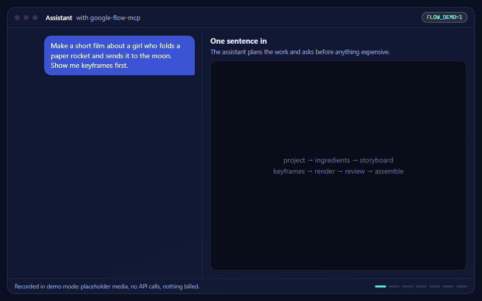
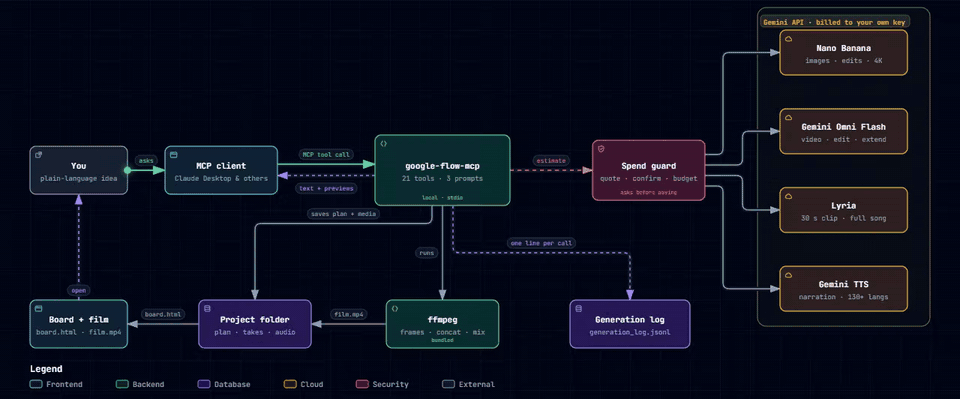
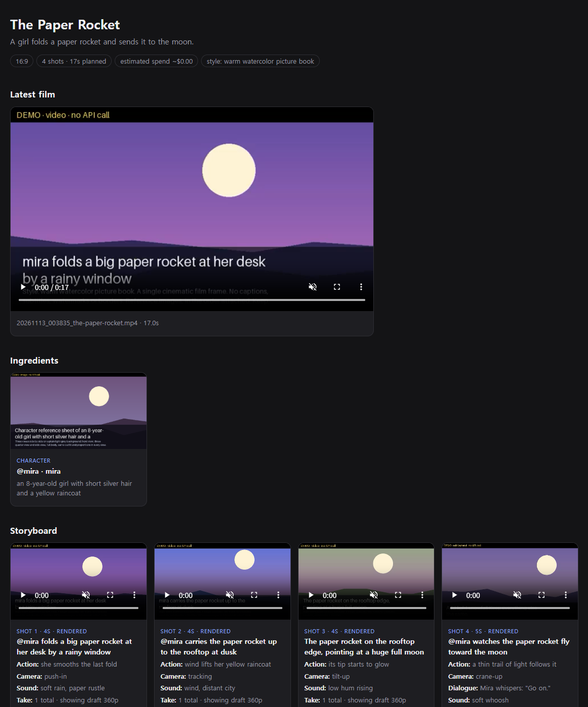
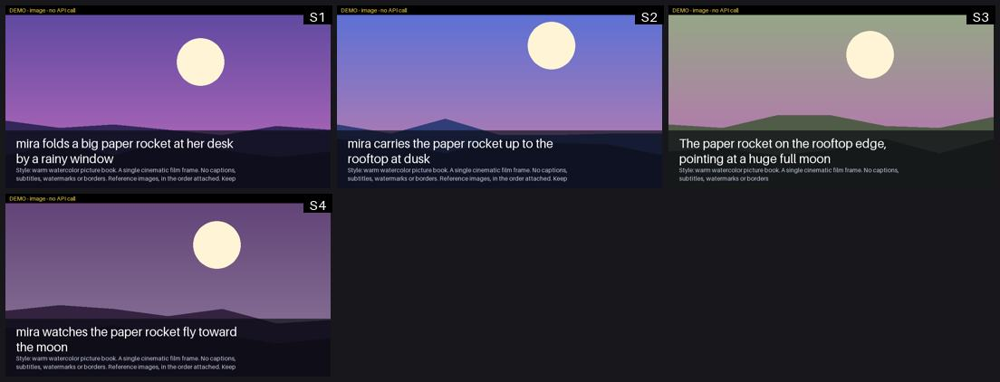
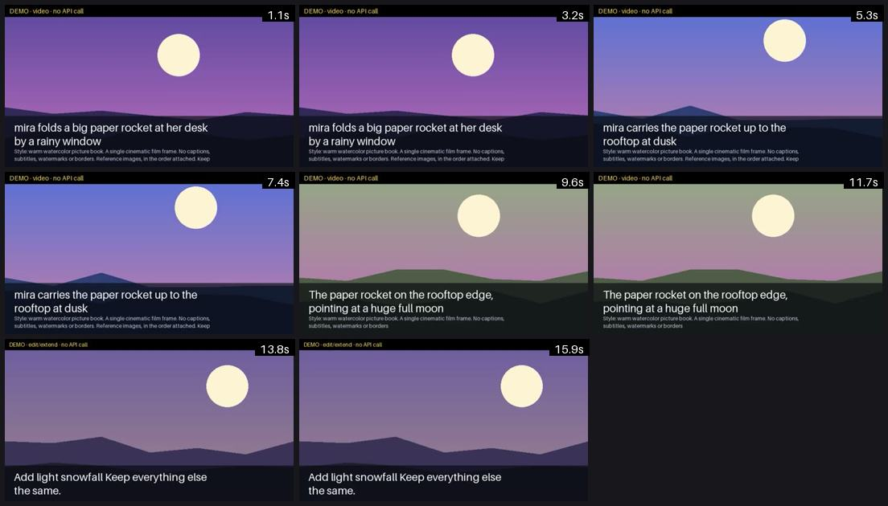

<p align="center">
  
</p>

<p align="center">
  <a href="https://github.com/Reasonofmoon/google-flow-mcp/actions/workflows/ci.yml"></a>
  
  
  
  
  
</p>

<p align="center">
  <a href="#작동-모습"><b>작동 모습</b></a> ·
  <a href="#작동-방식"><b>작동 방식</b></a> ·
  <a href="#api-키-없이-써-보기"><b>무료로 써 보기</b></a> ·
  <a href="#도구-21개"><b>도구</b></a> ·
  <a href="#설치"><b>설치</b></a> ·
  <a href="#문제-해결"><b>문제 해결</b></a> ·
  <a href="README.md"><b>English</b></a>
</p>

Claude 같은 MCP 클라이언트에게 말로 시키면 됩니다. 스토리보드를 짜고, 인물을 일관되게 유지하고,
샷을 렌더하고, 고치고, 음악과 내레이션을 넣고, 한 편의 영상으로 이어 붙입니다.

> **Google과 관련 없는 프로젝트입니다.** 이 서버는 Google Flow 웹앱을 조종하지 않고 Flow 크레딧도 쓰지
> 않습니다. Flow에서 하던 작업 방식을 공개된 **Gemini API**로 다시 만든 것입니다. 요금은 내 API 키로
> Google에 직접 냅니다.

## 작동 모습

<p align="center">
  
</p>
<p align="center"><sub><a href="#api-키-없이-써-보기">데모 모드</a>에서 녹화했습니다. 그림은 내 PC에서 만든 자리표시 카드이고, API를 부르지 않았으며 요금도 없습니다. 도구 호출, 예상 비용, 미리보기, 이어 붙이기, 보드는 실제 동작입니다.</sub></p>

## 무엇이 다른가

| Google Flow에서 | 여기서는 |
|---|---|
| **재료(Ingredients)·캐릭터**: 자산에 태그를 달아 다시 쓴다 | `flow_ingredient_save`로 저장하고 프롬프트에 `@mira`라고 쓰면 참고 이미지와 설명이 자동으로 붙는다 |
| **프레임에서 영상 만들기** | 샷마다 싼 키프레임을 먼저 만들고, 그것이 영상의 첫 장면이 된다. 첫 장면과 끝 장면을 함께 줄 수도 있다 |
| **Scenebuilder**: 배치, 자르기, 미리보기, 내려받기 | `flow_storyboard_plan` → `flow_storyboard_render` → `flow_assemble` (내장 ffmpeg로 내 PC에서 처리) |
| **연장·편집·넣기·지우기** | `flow_extend_video`, `flow_edit_video` ("눈이 조금 내리게", "애니메이션 풍으로") |
| **카메라 조작** | `camera="push-in"`, `"orbit"`, `"drone"` 등 18가지. 직접 써도 된다 |
| **360p 초안은 3분의 1 가격** | `quality="draft"`로 먼저 보고, 괜찮은 샷만 `"standard"`로 다시 만든다 |
| 프로젝트 화면 | `flow_board`가 재생기가 들어 있는 HTML 한 장을 만든다 |

웹앱이 못 하는 것도 세 가지 있습니다.

<table>
<tr>
<td width="33%" valign="top">

**만든 결과를 직접 본다**

이미지 도구는 미리보기를 함께 돌려주고, `flow_review`는 영상에서 고르게 뽑은 프레임을 돌려줍니다.
어시스턴트가 이상한 손이나 틀린 글자를 먼저 찾아낼 수 있습니다.

</td>
<td width="33%" valign="top">

**지출을 막아 준다**

결과마다 예상 비용을 보여 줍니다. 기준 금액을 넘는 작업은 견적만 먼저 돌려주고 동의를 기다립니다.
하루 개수 한도와 하루 예산이 기본으로 켜져 있습니다.

</td>
<td width="33%" valign="top">

**긴 작업이 끊기지 않는다**

샷을 백그라운드에서 동시에 렌더합니다. 도구는 몇 분 안에 돌아오고, 진행 상황은 `flow_project`로 봅니다.

</td>
</tr>
</table>

음악(Lyria)과 내레이션(Gemini TTS, 한국어 포함 130개 이상 언어)은 이어 붙일 때 함께 섞습니다.

## 작동 방식

### 요청 하나가 지나가는 길

서버는 내 PC에서 도는 프로그램입니다. 생성 요청만 밖으로 나가고, 나가기 전에 지출 확인을 거칩니다.

<p align="center">
  
</p>

<details>
<summary><b>요청이 흘러가는 모습 보기</b> (애니메이션)</summary>
<br>
<p align="center"></p>
</details>

### 한 문장에서 완성 영상까지

싼 단계가 먼저입니다. 정지 이미지로 그림을 확정하고, 견적을 보고 돈을 씁니다.

<p align="center">
  
</p>

<sub>두 그림은 밝은 테마와 어두운 테마에 맞춰 바뀝니다. <a href="https://github.com/tt-a1i/archify">Archify</a>로 만들었고 원본은 <a href="docs/diagrams">docs/diagrams</a>에 있습니다.</sub>

## 결과물

<table>
<tr>
<td width="52%" valign="top">

<p align="center"><sub><b>프로젝트 보드</b>: 완성 영상, 재료, 샷과 테이크</sub></p>
</td>
<td width="48%" valign="top">

<p align="center"><sub><b>키프레임 시트</b>: 영상에 돈을 쓰기 전에 어시스턴트가 보는 화면</sub></p>

<p align="center"><sub><b>flow_review</b>: 완성 영상에서 뽑은 프레임</sub></p>
</td>
</tr>
</table>

<p align="center"><sub>화면은 데모 모드 결과라서 그림이 자리표시 카드입니다. API 키를 넣으면 실제 이미지와 영상이 들어갑니다.</sub></p>

## API 키 없이 써 보기

`FLOW_DEMO=1`을 넣으면 모든 도구가 내 PC에서 만든 자리표시 결과로 동작합니다. 이미지는 장면 카드,
영상은 천천히 확대되는 클립, 소리는 약한 음입니다. Google로 아무것도 보내지 않고 요금도 없습니다.
프로젝트, 스토리보드, 미리보기, 예상 비용, 이어 붙이기, 보드는 실제처럼 동작합니다.

```bash
pip install -e .
python examples/offline_demo.py demo_output
# 그다음 demo_output/projects/paper-rocket/board.html 을 연다
```

Claude Desktop에서는 서버의 `env`에 `"FLOW_DEMO": "1"`을 추가합니다. 실제 키를 넣을 때는 이 줄을 지웁니다.

## 대화 한 번으로 영상 한 편

> **나:** 종이 로켓을 만드는 아이 이야기로 20초짜리 세로 영상을 만들어 줘.
>
> **어시스턴트:** 프로젝트를 만든다 → `@mira`를 참고 시트와 함께 저장한다 → 4개 샷을 기획한다 →
> 키프레임 4장을 만들어 시트로 보여 준다(약 $0.13) → 승인을 받으면 360p 초안을 렌더한다(약 $0.46) →
> 프레임을 검토하고 약한 샷 하나를 다시 렌더한다 → 30초 피아노 음악과 한국어 내레이션을 넣는다 →
> `paper-rocket.mp4`로 이어 붙이고 보드를 연다.

같은 흐름이 프롬프트로도 들어 있습니다: `short_film`, `product_ad`, `social_image_set`.

## 도구 21개

**바로 쓰는 도구**

| 도구 | 하는 일 |
|---|---|
| `flow_generate_image` | 글 → 이미지 1~4장. `preset`, `style`, `@재료` 태그, 최대 4K |
| `flow_edit_image` | 말로 이미지 고치기(넣기, 지우기, 바깥으로 넓히기, 배경 바꾸기) |
| `flow_generate_image_with_references` | 참고 이미지 최대 14장 |
| `flow_generate_video` | 글(+ 첫·끝 장면, 참고 이미지, `camera`) → 소리가 들어간 3~15초 영상 |
| `flow_extend_video` | 영상 이어 만들기, 합쳐서 최대 30초 |
| `flow_edit_video` | 한 문장으로 영상이나 스토리보드 샷 고치기 |
| `flow_image_to_video` | 기준 이미지 → 영상을 한 번에 |

**스튜디오**

| 도구 | 하는 일 |
|---|---|
| `flow_project` | 프로젝트 만들기·열기, 상태와 다음 할 일 보기 |
| `flow_ingredient_save` | 인물·사물·장소·스타일 저장(참고 시트 자동 생성 가능) |
| `flow_storyboard_plan` | 샷 목록 정하기. 키프레임·초안·표준 렌더 예상 비용을 돌려준다 |
| `flow_shot_update` | 샷 고치기, 테이크 고르기, 자르기 |
| `flow_storyboard_keyframes` | 샷마다 정지 이미지 1장과 확인용 시트 |
| `flow_storyboard_render` | 샷을 백그라운드로 렌더: `draft` / `standard` / `high` |
| `flow_generate_music` | Lyria 음악: 30초 클립 또는 한 곡 |
| `flow_generate_narration` | Gemini TTS 내레이션, 목소리 30종, 말투 지정 |
| `flow_assemble` | 테이크 이어 붙이기, 자르기 적용, 음악·내레이션 섞기(API 비용 없음) |
| `flow_review` | 이미지나 영상 프레임을 어시스턴트에게 돌려주기 |
| `flow_board` | 프로젝트 전체를 HTML 보드로 |

**관리:** `flow_list_presets`, `flow_estimate_cost`, `flow_usage_today`

## 모델과 가격

유료 등급 Standard 기준이고, 2026-11-13에 [가격 페이지](https://aistudio.google.com/docs/pricing)에서 확인했습니다.
예상치입니다. Google은 토큰 단위로 청구합니다.

| 작업 | 기본 모델 | 가격 |
|---|---|---|
| 이미지 fast(기본) | `gemini-nano-banana-2.1` | 약 $0.034(1K) / $0.050(2K) / $0.113(4K) |
| 이미지 pro | `gemini-3-pro-image` | 약 $0.134(1K·2K) / $0.24(4K) |
| 이미지 lite | `gemini-3.1-flash-lite-image` | 약 $0.034(1K) |
| 영상 | `gemini-omni-1.2-flash` | 초당 약 $0.023(360p), $0.07(720p), $0.104(1080p), $0.209(4K) |
| 음악 | `lyria-3-clip-preview` / `lyria-3.5` | 30초 클립 $0.04 / 한 곡 $0.08 |
| 내레이션 | `gemini-3.8-flash-tts` | 초당 약 $0.0002(무료 등급 있음) |

이미지·영상·음악 모델에는 **무료 등급이 없습니다.** 결제가 연결된 API 키가 필요합니다.
4샷 20초 영상 한 편은 대략 키프레임 $0.13 + 초안 $0.46 + 720p $1.40 + 음악 $0.04입니다.

## 설치

Python 3.11 이상과 [uv](https://docs.astral.sh/uv/)가 필요합니다. ffmpeg는 `imageio-ffmpeg`로 함께 설치됩니다.

```bash
git clone https://github.com/Reasonofmoon/google-flow-mcp
```

Claude Desktop → `claude_desktop_config.json`:

```json
{
  "mcpServers": {
    "google-flow": {
      "command": "uv",
      "args": ["--directory", "/path/to/google-flow-mcp", "run", "google-flow-mcp"],
      "env": {
        "GOOGLE_API_KEY": "YOUR_PAID_GEMINI_API_KEY",
        "FLOW_OUTPUT_DIR": "/path/to/output"
      }
    }
  }
}
```

설정 파일 위치: `%APPDATA%\Claude\claude_desktop_config.json`(Windows),
`~/Library/Application Support/Claude/claude_desktop_config.json`(macOS),
`~/.config/Claude/claude_desktop_config.json`(Linux).

고친 뒤에는 앱을 **완전히 종료**하고 다시 엽니다(트레이나 메뉴 막대 아이콘 → Quit). 창만 닫으면 적용되지
않습니다. 그다음 "flow_list_presets 보여줘"라고 해 봅니다.

Claude Code:

```bash
claude mcp add google-flow -s user \
  -e GOOGLE_API_KEY=YOUR_PAID_GEMINI_API_KEY -e FLOW_OUTPUT_DIR=/path/to/output \
  -- uv --directory /path/to/google-flow-mcp run google-flow-mcp
```

### 어떤 API 키를 써야 하나

Google AI Studio에서 **결제가 연결된** 프로젝트의 키를 씁니다. [API 키 화면](https://aistudio.google.com/api-keys)에
"Tier 1" 이상으로 표시됩니다. Google 가격표에 이미지·영상·음악 모델의 무료 등급이 없어서, "Free tier"로
표시된 키로는 만들 수 없습니다. 아래 요청은 무료이고 아무것도 만들지 않습니다. 내 키에서 영상 모델이
보이는지만 알려 줍니다.

```bash
curl -s -H "x-goog-api-key: $GOOGLE_API_KEY" \
  https://generativelanguage.googleapis.com/v1beta/models/gemini-omni-1.2-flash
```

모델 설명(JSON)이 나오면 키에서 모델이 보이는 것이고, 오류가 나오면 보이지 않는 것입니다. 결제 상태는
이 요청으로 알 수 없고, 실제로 처음 만들 때 드러납니다.

### 설치 점검

```bash
python examples/mcp_smoke_test.py
```

실제 서버를 띄워 MCP로 대화하면서 데모 모드로 영상 한 편을 끝까지 만듭니다(프로젝트, 재료, 스토리보드,
키프레임, 백그라운드 렌더, 편집, 음악, 내레이션, 이어 붙이기, 검토, 보드). 키가 없을 때 안내 오류가
제대로 나오는지도 확인합니다. API 키를 쓰지 않고 요금도 없습니다. 마지막 줄에
`SUMMARY 26/26 checks passed`가 나오면 정상입니다.

## 설정

<details>
<summary><b>환경 변수</b> (모델, 한도, 경로)</summary>
<br>

| 변수 | 기본값 | 뜻 |
|---|---|---|
| `GOOGLE_API_KEY` | 없음 | Gemini API 키(`FLOW_DEMO=1`이 아니면 필수) |
| `FLOW_OUTPUT_DIR` | `~/google_flow_outputs` | 결과 파일, 기록, `projects/` 위치 |
| `FLOW_DEMO` | 끔 | `1`이면 자리표시 결과만 만든다. API 호출과 요금 없음 |
| `FLOW_DEFAULT_IMAGE_MODEL` | `fast` | `fast`, `pro`, `lite` 또는 모델 이름 |
| `FLOW_MODEL_IMAGE_FAST` / `_PRO` / `_LITE`, `FLOW_MODEL_VIDEO`, `FLOW_MODEL_MUSIC_CLIP` / `_SONG`, `FLOW_MODEL_TTS` | 위 표 참고 | 코드 수정 없이 모델 바꾸기 |
| `FLOW_DAILY_BUDGET_USD` | `5` | 하루 예상 지출 한도, `0`이면 끔 |
| `FLOW_DAILY_IMAGE_LIMIT` / `FLOW_DAILY_VIDEO_LIMIT` | `100` / `20` | 하루 개수 한도, `0`이면 끔 |
| `FLOW_VIDEO_CONFIRM_USD` | `0.5` | 이보다 비싼 영상 작업은 견적부터 돌려준다 |
| `FLOW_INLINE_PREVIEW` | `1` | 미리보기를 어시스턴트에게 돌려준다 |
| `FLOW_RENDER_WAIT_SECONDS` / `FLOW_RENDER_CONCURRENCY` | `150` / `2` | 스토리보드 렌더 대기 시간과 동시 개수 |
| `FLOW_PRESETS_FILE`, `FLOW_PRICES_FILE` | 없음 | 내 프리셋, 내 가격표(JSON) |
| `FLOW_PROJECTS_DIR`, `FLOW_LOG_FILE`, `FLOW_FFMPEG` | 없음 | 경로 바꾸기 |
| `FLOW_API_VERSION` | `v1beta` | Gemini API 버전. 영상·음악·TTS 모델은 `v1`에 없다 |

한도와 지출은 Google 청구서가 아니라 내 PC의 `generation_log.jsonl`로 계산한 추정치입니다.

</details>

## 프로젝트 폴더 구조

```
projects/paper-rocket/
  project.json        기획, 재료, 테이크, 지출 (일반 JSON)
  board.html          브라우저로 연다
  ingredients/        참고 이미지
  keyframes/  shots/  audio/  renders/
```

서버는 프로젝트 파일을 지우지 않습니다. 다시 렌더하면 테이크가 추가됩니다.

## 알아둘 점

- `standard` 렌더는 같은 키프레임에서 새로 만드는 것이라, 초안과 움직임이 다를 수 있습니다.
- `flow_review`는 프레임만 보여 줍니다. 어시스턴트는 소리를 들을 수 없습니다.
- 영상은 샷당 3~15초(끝 장면을 주면 3~10초), 참고 이미지 최대 6장, 16:9 또는 9:16입니다.
  편집과 연장은 15초 이하 클립에서 됩니다.
- 영상 프롬프트는 영어가 공식 지원입니다. 다른 언어도 되지만 공식 평가는 없습니다.
- 이미지, 영상, 소리에는 Google의 보이지 않는 SynthID 워터마크가 들어갑니다.
- 일부 업로드는 지역이나 내용에 따라 제한됩니다(알아볼 수 있는 인물, EEA·영국·스위스의 미성년자 이미지 등).

## 문제 해결

| 보이는 것 | 이유 | 할 일 |
|---|---|---|
| `404 ... Model 'gemini-omni-1.2-flash' not found` | 0.3.3 이전 버전은 `v1` 주소로 요청했는데, 거기에는 영상·음악·TTS 모델이 없다 | 0.3.3 이상으로 올리고(`git pull`) 클라이언트를 다시 시작한다. `flow_list_presets`에 `Gemini API version: v1beta`가 보여야 한다 |
| `veo-3.1-generate-preview`가 `404` | Veo 3.1 Preview는 2026-10-22에 서비스가 끝났다. 키 문제가 아니다 | 원본 0.1.0 대신 이 서버(Gemini Omni Flash)를 쓴다 |
| `flow_*` 도구가 두 벌 보이거나 엉뚱한 쪽이 답한다 | 원본 `google-flow-mcp` 0.1.0이 함께 등록돼 있다. 도구 이름이 같다 | 예전 항목을 뺀다. 예: `claude mcp remove google-flow -s user`. 또는 `claude_desktop_config.json`에서 지운다 |
| `402`, "prepayment credits are depleted" | 키의 프로젝트가 선불인데 잔액이 없다 | 충전하거나, 결제와 잔액이 있는 프로젝트의 키를 쓴다 |
| 이미지·영상·음악은 실패하는데 `flow_generate_narration`은 된다 | 무료 등급 키일 가능성이 크다. 내레이션에만 무료 등급이 있다 | 결제가 연결된 프로젝트의 키를 쓴다([어떤 API 키를 써야 하나](#어떤-api-키를-써야-하나)) |
| `GOOGLE_API_KEY is not set` | 서버 `env`에 키가 없거나 자리표시 값이 그대로다 | 키를 넣거나, `FLOW_DEMO=1`로 키 없이 써 본다 |
| 설정이나 코드를 바꿨는데 그대로다 | 클라이언트가 예전 서버 프로세스를 붙잡고 있다 | 클라이언트를 완전히 종료하고 다시 연다 |
| `NOT GENERATED YET. Estimated cost ...` | 오류가 아니다. 작업이 `FLOW_VIDEO_CONFIRM_USD`를 넘었다 | 동의하면 어시스턴트가 `confirm_cost=true`로 다시 부른다 |
| `Daily budget reached` | 예상 지출이 `FLOW_DAILY_BUDGET_USD`(기본 $5)를 넘었다 | `env`에서 한도를 올리거나 내일 이어서 한다 |

실패와 오류 문구를 포함해 모든 호출이 `<FLOW_OUTPUT_DIR>/generation_log.jsonl`에 남습니다.
이슈를 올릴 때 해당 줄을 붙여 주세요.

## 상태

알파 단계입니다. CI는 Linux(Python 3.11~3.13, `mcp` 1.x와 2.x), Windows, macOS에서 돕니다. 테스트 51개는
Google API를 흉내 내고 ffmpeg와 Pillow는 실제로 실행합니다. 위의 설치 점검 스크립트도 실제 서버
프로세스를 상대로 돌립니다.

실제 API 상태(2026-11-13 기준): 첫 실제 호출(영상)은 API 버전 버그로 실패했고, 0.3.3에서 고쳤습니다.
**0.3.3으로 실제 생성이 성공하는 것은 아직 확인하지 못했습니다.** 요청 형식은 공식 문서를 따랐습니다.
실제 호출이 다르게 동작하면 이슈로 알려 주세요.

```bash
pip install -e ".[dev]" && pytest -v
```

## 출처와 라이선스

- joshua-daniel-8090의 [google-flow-mcp 0.1.0](https://pypi.org/project/google-flow-mcp/)을 고쳐 만들었습니다. 바뀐 내용은 [CHANGELOG.md](CHANGELOG.md)에 있습니다.
- 다이어그램은 [Archify](https://github.com/tt-a1i/archify)(Apache-2.0)로 만들었습니다.
- 코드를 고치거나 원본과 맞추는 방법은 [FORK.md](FORK.md)에 있습니다.
- Apache 2.0: [LICENSE](LICENSE), [NOTICE](NOTICE).
  "Google", "Gemini", "Flow", "Veo", "Lyria", "Nano Banana"는 Google LLC의 상표입니다.
