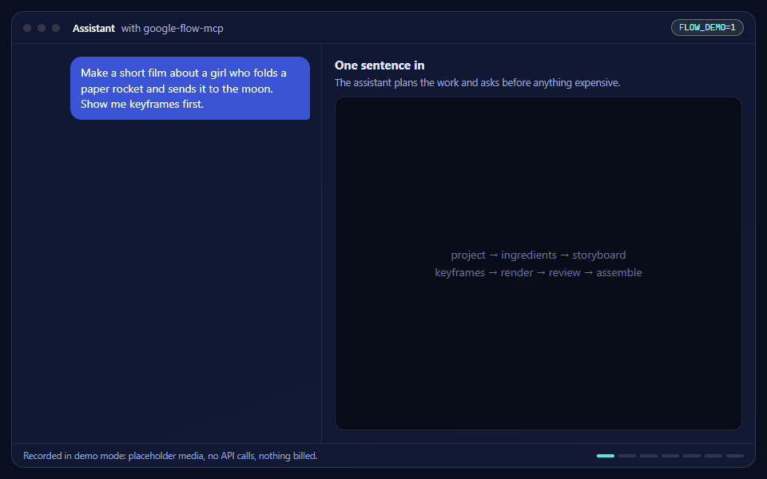
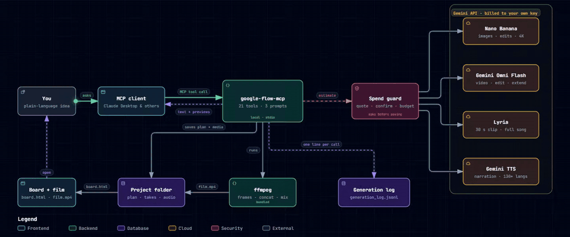
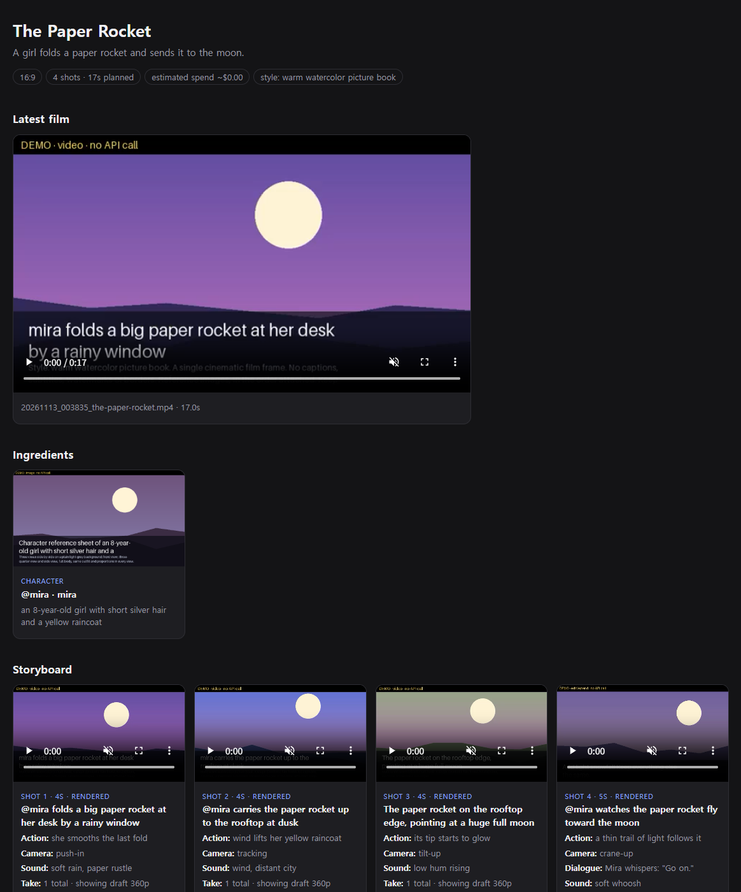
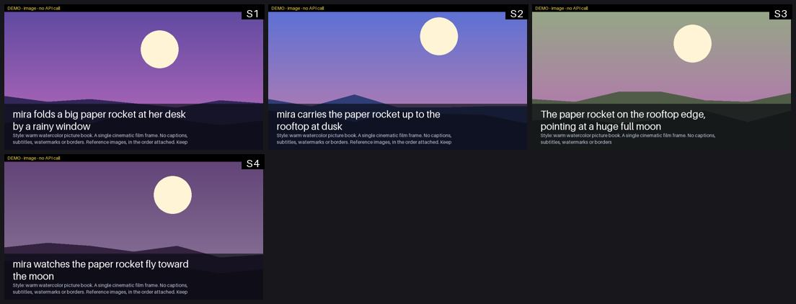
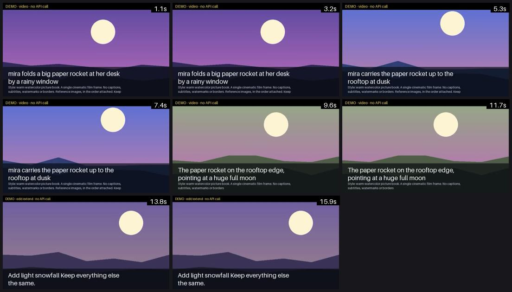

<p align="center">
  
</p>

<p align="center">
  <a href="https://github.com/Reasonofmoon/google-flow-mcp/actions/workflows/ci.yml"></a>
  
  
  
  
  
</p>

<p align="center">
  <a href="#see-it-work"><b>Demo</b></a> ·
  <a href="#how-it-works"><b>How it works</b></a> ·
  <a href="#try-it-without-an-api-key"><b>Try it free</b></a> ·
  <a href="#tools-21"><b>Tools</b></a> ·
  <a href="#install"><b>Install</b></a> ·
  <a href="FORK.md"><b>한국어</b></a>
</p>

Plan a storyboard, keep characters consistent, render shots, edit them, add music and a
voice-over, and cut the film together, all by talking to Claude or any other MCP client.

> **Not affiliated with Google.** This server does not control the Google Flow web app and does
> not use Flow credits. It rebuilds Flow's way of working on the public **Gemini API**, so you
> pay Google directly through your own API key.

## See it work

<p align="center">
  
</p>
<p align="center"><sub>Recorded in <a href="#try-it-without-an-api-key">demo mode</a>: the pictures are local placeholders, no API was called and nothing was billed. The tool calls, cost estimates, previews, assembly and board are the real thing.</sub></p>

## What makes it different

| In Google Flow | Here |
|---|---|
| **Ingredients / Characters**: tag an asset to reuse it | `flow_ingredient_save`, then write `@mira` in any prompt. Reference images and a description are attached for you |
| **Frames to Video** | A cheap keyframe per shot becomes the first frame of its video; first + last frame also works |
| **Scenebuilder**: arrange, trim, preview, download | `flow_storyboard_plan` → `flow_storyboard_render` → `flow_assemble` (local ffmpeg, bundled) |
| **Extend / edit / insert / remove** | `flow_extend_video`, `flow_edit_video` ("Add light snowfall", "Make this anime") |
| **Camera controls** | `camera="push-in"`, `"orbit"`, `"drone"`: 18 presets or your own words |
| **Draft at 360p for a third of the cost** | `quality="draft"`, then `"standard"` only for shots that work |
| Project view | `flow_board` writes a self-contained HTML board with players |

And three things the web app cannot do:

<table>
<tr>
<td width="33%" valign="top">

**It looks at its own work**

Image tools return a preview and `flow_review` returns evenly spaced video frames, so the
assistant can catch a broken hand or a misspelled title before you do.

</td>
<td width="33%" valign="top">

**Spending is guarded**

Every result shows an estimated price. Anything above a threshold returns a quote first and
waits for your yes. Daily limits and a daily budget are on by default.

</td>
<td width="33%" valign="top">

**Long jobs do not time out**

Shots render in parallel as background jobs. The tool returns after a couple of minutes and
`flow_project` shows progress.

</td>
</tr>
</table>

Music (Lyria) and narration (Gemini TTS, 130+ languages) are mixed in at assembly.

## How it works

### A request, end to end

The server is a local process. Only generation requests leave your machine, and each one passes
the spend guard first.

<p align="center">
  
</p>

<details>
<summary><b>Watch the request travel</b> (animation)</summary>
<br>
<p align="center"></p>
</details>

### From one sentence to a finished film

Cheap steps come first. You approve the look on stills, then the money on a quote.

<p align="center">
  
</p>

<sub>Both diagrams follow your light or dark theme. They were made with <a href="https://github.com/tt-a1i/archify">Archify</a>; the sources are in <a href="docs/diagrams">docs/diagrams</a>.</sub>

## What you get

<table>
<tr>
<td width="52%" valign="top">

<p align="center"><sub><b>Project board</b>: film, ingredients, and every shot with its takes</sub></p>
</td>
<td width="48%" valign="top">

<p align="center"><sub><b>Keyframe sheet</b>: what the assistant sees before any video is paid for</sub></p>

<p align="center"><sub><b>flow_review</b>: frames sampled through the finished cut</sub></p>
</td>
</tr>
</table>

<p align="center"><sub>Screenshots are from demo mode, so the pictures are placeholder cards. With an API key they are real images and video.</sub></p>

## Try it without an API key

Set `FLOW_DEMO=1` and every tool works with local placeholder media: scene cards for images,
slow-zoom clips for video, a soft tone for audio. Nothing is sent to Google and nothing is billed,
but projects, storyboards, previews, cost estimates, assembly and the board all behave for real.

```bash
pip install -e .
python examples/offline_demo.py demo_output
# then open demo_output/projects/paper-rocket/board.html
```

In Claude Desktop, add `"FLOW_DEMO": "1"` to the server's `env` block. Remove it when you add a key.

## A film in one conversation

> **You:** Make a 20-second vertical short about a girl who builds a paper rocket.
>
> **Assistant:** creates the project → saves `@mira` with a reference sheet → plans 4 shots →
> generates 4 keyframes and shows you the contact sheet (about $0.13) → after your OK renders
> 360p drafts (about $0.46) → reviews frames, re-renders one weak shot → adds a 30-second piano
> clip and a Korean voice-over → assembles `paper-rocket.mp4` and opens the board.

The same flow is available as ready-made prompts: `short_film`, `product_ad`, `social_image_set`.

## Tools (21)

**Quick jobs**

| Tool | Does |
|---|---|
| `flow_generate_image` | Text → 1–4 images; `preset`, `style`, `@ingredient` tags; up to 4K |
| `flow_edit_image` | Edit with plain language (add, remove, extend canvas, swap background) |
| `flow_generate_image_with_references` | Up to 14 reference images |
| `flow_generate_video` | Text (+ first/last frame, references, `camera`) → 3–15 s video with audio |
| `flow_extend_video` | Continue a clip, up to 30 s total |
| `flow_edit_video` | Change a clip or a storyboard shot with one sentence |
| `flow_image_to_video` | Anchor image → video in one call |

**Studio**

| Tool | Does |
|---|---|
| `flow_project` | Create/open a project, or show status and the next step |
| `flow_ingredient_save` | Save a character, object, location or style (optionally generate a reference sheet) |
| `flow_storyboard_plan` | Set the shot list; returns keyframe, draft and standard cost estimates |
| `flow_shot_update` | Rewrite a shot, pick a take, trim it |
| `flow_storyboard_keyframes` | One still per shot + a contact sheet to check the look |
| `flow_storyboard_render` | Render shots in the background at `draft` / `standard` / `high` |
| `flow_generate_music` | Lyria: 30 s clip or full song |
| `flow_generate_narration` | Gemini TTS voice-over, 30 voices, style control |
| `flow_assemble` | Join takes, apply trims, mix music and narration (no API cost) |
| `flow_review` | Return an image or video frames for the assistant to inspect |
| `flow_board` | HTML board of the whole project |

**Housekeeping:** `flow_list_presets`, `flow_estimate_cost`, `flow_usage_today`

## Models and list prices

Paid tier, Standard, checked 2026-11-13 on [the pricing page](https://aistudio.google.com/docs/pricing).
Estimates only: Google bills by tokens.

| Job | Default model | Price |
|---|---|---|
| Image, fast (default) | `gemini-nano-banana-2.1` | ~$0.034 (1K) / $0.050 (2K) / $0.113 (4K) |
| Image, pro | `gemini-3-pro-image` | ~$0.134 (1K/2K) / $0.24 (4K) |
| Image, lite | `gemini-3.1-flash-lite-image` | ~$0.034 (1K) |
| Video | `gemini-omni-1.2-flash` | ~$0.023/s (360p), $0.07/s (720p), $0.104/s (1080p), $0.209/s (4K) |
| Music | `lyria-3-clip-preview` / `lyria-3.5` | $0.04 per 30 s clip / $0.08 per song |
| Narration | `gemini-3.8-flash-tts` | ~$0.0002/s (free tier available) |

Image, video and music models have **no free tier**: the API key needs billing enabled.
A 20-second, 4-shot film costs roughly $0.13 (keyframes) + $0.46 (draft) + $1.40 (720p) + $0.04 (music).

## Install

Requires Python 3.11+ and [uv](https://docs.astral.sh/uv/). ffmpeg is bundled through `imageio-ffmpeg`.

```bash
git clone https://github.com/Reasonofmoon/google-flow-mcp
```

Claude Desktop → `claude_desktop_config.json`:

```json
{
  "mcpServers": {
    "google-flow": {
      "command": "uv",
      "args": ["--directory", "/path/to/google-flow-mcp", "run", "google-flow-mcp"],
      "env": {
        "GOOGLE_API_KEY": "YOUR_PAID_GEMINI_API_KEY",
        "FLOW_OUTPUT_DIR": "/path/to/output"
      }
    }
  }
}
```

Config file: `%APPDATA%\Claude\claude_desktop_config.json` (Windows),
`~/Library/Application Support/Claude/claude_desktop_config.json` (macOS),
`~/.config/Claude/claude_desktop_config.json` (Linux). Restart the app after editing.
Then ask: *"Show me flow_list_presets."*

### Check your install

```bash
python examples/mcp_smoke_test.py
```

This starts the real stdio server, speaks MCP to it and makes a whole film in demo mode
(project, ingredient, storyboard, keyframes, background render, edit, music, narration,
assembly, review, board), then checks that a missing key produces a helpful error.
No API key, nothing billed. Expect `SUMMARY 26/26 checks passed`.

## Settings

<details>
<summary><b>Environment variables</b> (models, limits, paths)</summary>
<br>

| Variable | Default | Meaning |
|---|---|---|
| `GOOGLE_API_KEY` | — | Gemini API key (required unless `FLOW_DEMO=1`) |
| `FLOW_OUTPUT_DIR` | `~/google_flow_outputs` | Files, log and `projects/` |
| `FLOW_DEMO` | off | `1` = placeholder media, no API calls, nothing billed |
| `FLOW_DEFAULT_IMAGE_MODEL` | `fast` | `fast`, `pro`, `lite` or a model id |
| `FLOW_MODEL_IMAGE_FAST` / `_PRO` / `_LITE`, `FLOW_MODEL_VIDEO`, `FLOW_MODEL_MUSIC_CLIP` / `_SONG`, `FLOW_MODEL_TTS` | see above | Swap models without code changes |
| `FLOW_DAILY_BUDGET_USD` | `5` | Estimated spend per day, `0` = off |
| `FLOW_DAILY_IMAGE_LIMIT` / `FLOW_DAILY_VIDEO_LIMIT` | `100` / `20` | Per day, `0` = off |
| `FLOW_VIDEO_CONFIRM_USD` | `0.5` | Video jobs above this return a quote first |
| `FLOW_INLINE_PREVIEW` | `1` | Return previews to the assistant |
| `FLOW_RENDER_WAIT_SECONDS` / `FLOW_RENDER_CONCURRENCY` | `150` / `2` | Storyboard render behavior |
| `FLOW_PRESETS_FILE`, `FLOW_PRICES_FILE` | — | Your own presets / price table (JSON) |
| `FLOW_PROJECTS_DIR`, `FLOW_LOG_FILE`, `FLOW_FFMPEG` | — | Path overrides |

Limits and spend are counted from the local `generation_log.jsonl`, not from Google's billing.

</details>

## What a project looks like on disk

```
projects/paper-rocket/
  project.json        plan, ingredients, takes, spend (plain JSON)
  board.html          open in a browser
  ingredients/        reference images
  keyframes/  shots/  audio/  renders/
```

The server never deletes project files; re-rendering adds takes.

## Good to know

- A `standard` render is a new generation from the same keyframe, so motion can differ from the draft.
- `flow_review` shows frames only. The assistant cannot hear audio.
- Video: 3–15 s per shot (3–10 s with a last frame), up to 6 reference images, 16:9 or 9:16.
  Edits and extensions work on clips of 15 s or less.
- English prompts are fully supported for video; other languages work but are not officially evaluated.
- Images, video and audio carry Google's invisible SynthID watermark.
- Some uploads are restricted by region or content (recognizable people, minors in the EEA/UK/CH).

## Status

Alpha. CI runs on Linux (Python 3.11–3.13, `mcp` 1.x and 2.x), Windows and macOS: 49 tests that
mock Google's API and run ffmpeg and Pillow for real, plus the stdio smoke test above against a
live server process. Request shapes follow the official docs as of 2026-11-13;
**no live API generation has been verified yet**, so please open an issue if a real call behaves
differently.

```bash
pip install -e ".[dev]" && pytest -v
```

## Credits and license

- Fork of [google-flow-mcp 0.1.0](https://pypi.org/project/google-flow-mcp/) by joshua-daniel-8090. See [CHANGELOG.md](CHANGELOG.md) for what changed.
- Diagrams made with [Archify](https://github.com/tt-a1i/archify) (Apache-2.0).
- Apache 2.0: see [LICENSE](LICENSE) and [NOTICE](NOTICE).
  "Google", "Gemini", "Flow", "Veo", "Lyria" and "Nano Banana" are trademarks of Google LLC.
